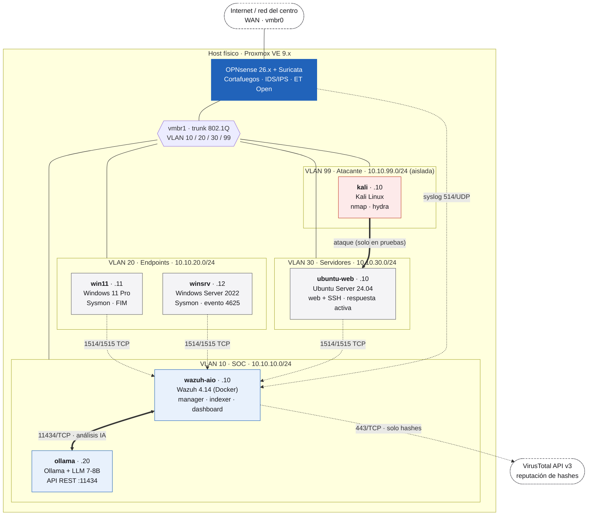

# Centro de Operaciones de Seguridad asistido por IA local

**Propuesta de un SOC para una cooperativa oleícola, validada en un laboratorio virtualizado.**
Proyecto final del módulo *Incidentes de Ciberseguridad* · Curso de Especialización en Ciberseguridad (CETI)

> Oleosierra, S. Coop. And. y todos sus datos son **ficticios**. Las pruebas ofensivas se realizan solo en un laboratorio aislado, sobre sistemas propios y con fines académicos y defensivos.

---

## ¿De qué trata el proyecto?

Este repositorio contiene la memoria (en LaTeX) de un proyecto que diseña, implanta en laboratorio y valida un **Centro de Operaciones de Seguridad (SOC)** para una pyme agroalimentaria que hoy no tiene ninguna capacidad de detectar ni responder a incidentes.

El SOC se construye únicamente con software libre o gratuito y combina:

- **Un SIEM (Wazuh)** que centraliza los eventos de equipos, cortafuegos y sistema de detección de intrusiones.
- **Detección en red y en equipos:** Suricata con reglas ET Open, telemetría de Sysmon y reglas propias asociadas a MITRE ATT&CK.
- **Un analista de IA que funciona en local (Ollama):** resume y prioriza las alertas para reducir la fatiga de alertas. Los registros contienen datos personales y no salen de la organización. La IA solo recomienda; decide siempre una persona.
- **Procedimientos organizativos:** playbooks de respuesta, plan de concienciación y procedimiento de notificación a las autoridades.

## El caso: Oleosierra

Cooperativa ficticia de Sierra Mágina (Jaén) con 1.200 socios, 38 trabajadores fijos (hasta unos 90 en campaña) y 14 millones de euros de facturación. Su actividad es muy estacional: una parada de pocos días en plena campaña de recolección tendría consecuencias económicas graves.

Su situación de partida es la habitual en una pyme del sector:

- Red plana donde conviven oficinas, servidor Windows y sistema de control de la almazara.
- Copias de seguridad en un NAS alcanzable desde la misma red.
- Acceso remoto de la gestoría por escritorio remoto.
- Un único técnico informático y ningún procedimiento de respuesta a incidentes.

Tras un intento de fraude por correo y un ataque de ransomware a otra cooperativa de la comarca, el consejo rector pide mejorar su capacidad de detección y respuesta. Los incidentes considerados más probables son **ransomware**, **phishing con fraude por correo** y **acceso no autorizado con credenciales robadas**.

## Objetivos

1. Analizar riesgos y superficie de ataque e identificar los incidentes más probables.
2. Desplegar la infraestructura en Proxmox VE con la red segmentada en cuatro VLAN.
3. Configurar OPNsense (mínimo privilegio) y Suricata (primero IDS, después IPS).
4. Desplegar Wazuh sobre Docker y centralizar en él todas las fuentes de eventos.
5. Integrar VirusTotal con la monitorización de integridad de ficheros y la respuesta activa.
6. Integrar Wazuh con un modelo de lenguaje local y evaluar si reduce el trabajo de triaje.
7. Validar la solución con siete escenarios de ataque controlados.
8. Elaborar playbooks, plan de concienciación y procedimiento de notificación.
9. Estimar el coste de implantación y de operación.

## Arquitectura del laboratorio

Todo se ejecuta en un único servidor con Proxmox VE. **OPNsense** es la única puerta de enlace: separa el laboratorio de la red exterior y filtra el tráfico entre cuatro VLAN. **Suricata** inspecciona las interfaces internas y todos los eventos convergen en **Wazuh**, que consulta la reputación de los ficheros en **VirusTotal** (solo envía hashes) y pasa las alertas relevantes al modelo de lenguaje local.

### Diagrama de red

*Las líneas discontinuas son telemetría hacia el SIEM; las gruesas, análisis de IA o tráfico de ataque simulado. OPNsense controla todos los flujos entre VLAN.*

### Segmentación y política de filtrado

| VLAN | Red | Función |
|---|---|---|
| 10 · SOC | `10.10.10.0/24` | SIEM (`wazuh-aio`) y servidor de IA (`ollama`) |
| 20 · Endpoints | `10.10.20.0/24` | Puesto y servidor Windows (red de oficina) |
| 30 · Servidores | `10.10.30.0/24` | Servidor Linux con web y SSH |
| 99 · Atacante | `10.10.99.0/24` | Kali Linux, aislada del SOC |

La política es de **denegación por defecto**: solo se permiten los flujos imprescindibles (envío de eventos de los agentes a Wazuh, syslog de OPNsense, acceso al panel, consulta de Wazuh a Ollama y a VirusTotal) y se registra el resto. La máquina atacante nunca puede alcanzar la red del SOC, y el modelo de lenguaje solo es accesible desde el SIEM.

## Tecnologías

| Componente | Función |
|---|---|
| **Proxmox VE** | Hipervisor, redes virtuales con VLAN y snapshots para restaurar el laboratorio antes de cada prueba |
| **OPNsense + Suricata** | Cortafuegos, enrutamiento inter-VLAN e IDS/IPS con reglas ET Open |
| **Wazuh** (Docker) | SIEM/XDR: reglas, integridad de ficheros, vulnerabilidades, MITRE ATT&CK y respuesta activa |
| **Sysmon** | Telemetría avanzada de Windows: procesos, conexiones, acceso a LSASS, registro |
| **VirusTotal API v3** | Reputación de los hashes de ficheros sospechosos |
| **Ollama + LLM 7–8B** | Análisis y explicación de alertas, en local |
| **Kali Linux + Atomic Red Team** | Generación controlada de actividad maliciosa para validar la detección |

## Alcance

**Incluye** el diseño completo del SOC y su validación en un laboratorio de siete máquinas virtuales.

**No incluye** el despliegue en producción, la alta disponibilidad de Wazuh, la respuesta automática decidida por la IA, el uso de malware real (solo ficheros de prueba EICAR), el análisis forense profundo, la monitorización del sistema de control de la almazara ni la vigilancia de los servicios en la nube.

## Contenido de la memoria

1. **Introducción y justificación:** contexto, problema, objetivos y alcance.
2. **Desarrollo técnico:** análisis de riesgos, arquitectura, implantación, triaje con IA, validación, playbooks, concienciación, notificación y costes.
3. **Marco normativo:** RGPD y LOPDGDD, NIS2, ISO/IEC 27001 y Reglamento de IA.
4. **Conclusiones** y **referencias** (APA 7.ª edición).
5. **Anexos:** evidencias, configuraciones, informes de incidentes, playbooks y plantillas.

El documento se escribe en `main.tex` y el PDF compilado está en la carpeta [`build/`](build/). Para compilarlo, ejecuta `pdflatex main.tex` dos veces (para que el índice quede resuelto).

> El proyecto está en desarrollo: algunos capítulos de la memoria aún contienen texto guía pendiente de redactar.

## Autoría

**Daniel Damota Maldonado** · Módulo *Incidentes de Ciberseguridad* · Tutor: Carlos Basulto Pardo
Curso de Especialización en Ciberseguridad (CETI), 2026–2027
